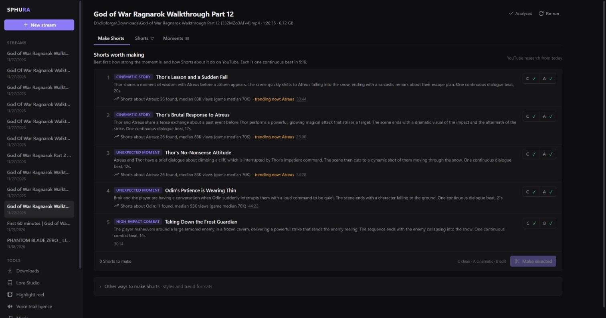
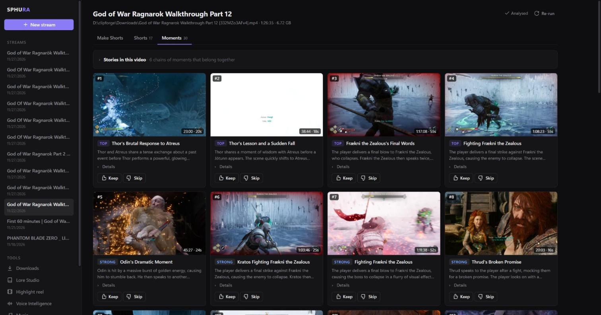
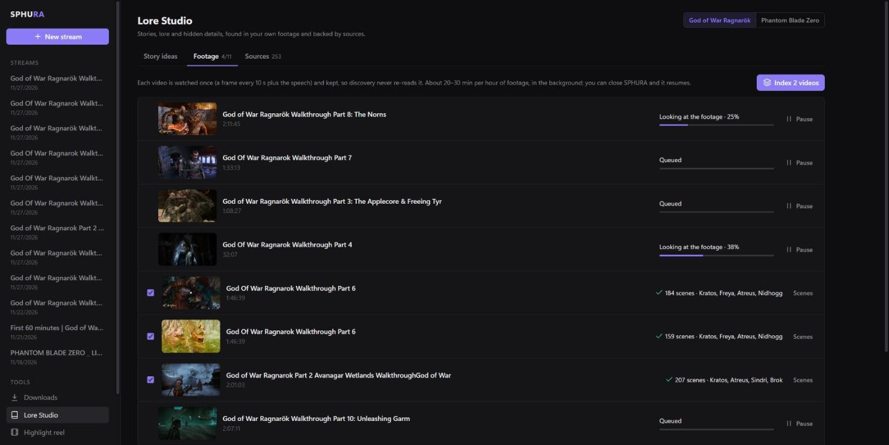
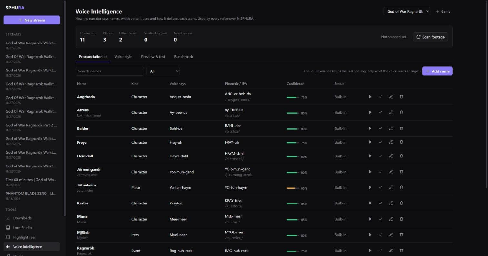
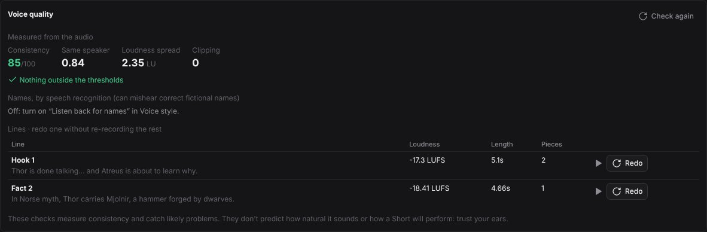
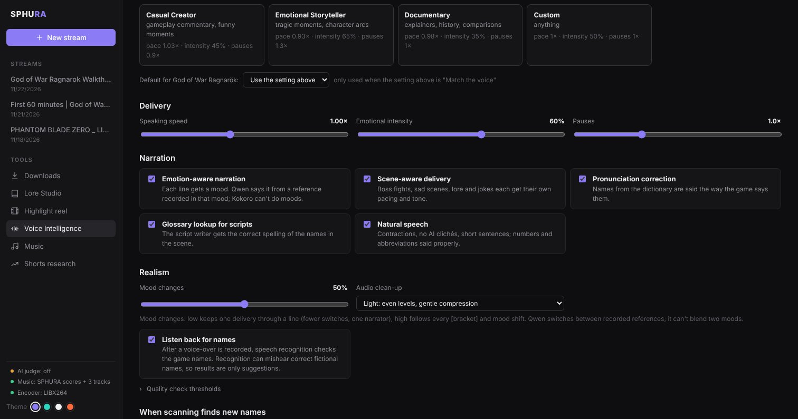
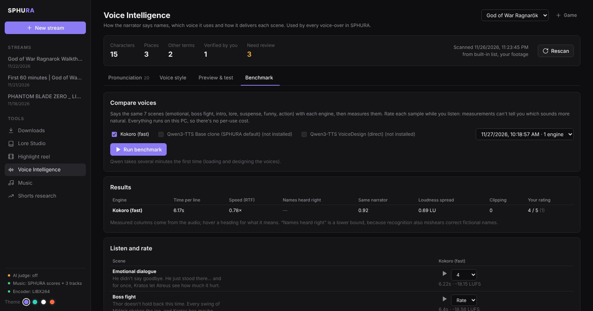
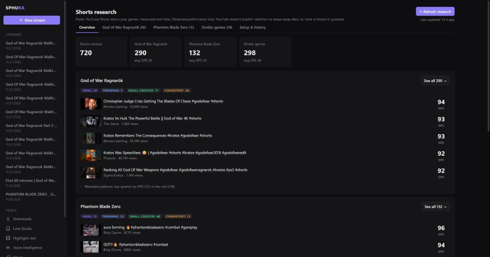
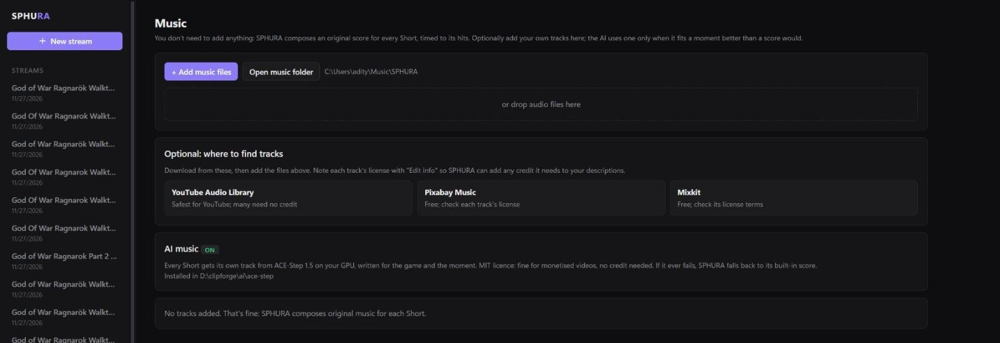

# SPHURA

**An AI-powered gaming video editor that turns long streams and recordings into ready-to-post YouTube Shorts.**

Point SPHURA at a multi-hour gameplay recording (or a YouTube video you own). It watches and listens to the whole thing, finds the moments worth sharing, ranks them against what actually gets views on YouTube for that game, and cuts each one into a vertical Short with effects, captions, music, an optional AI narrator, a title, a description and hashtags. It runs on your own PC: the video never leaves it unless you choose a cloud AI judge.

Development history: [CHANGELOG.md](CHANGELOG.md) · Technical design: [docs/ARCHITECTURE.md](docs/ARCHITECTURE.md)

## Contents

- [Features](#features)
- [Screenshots](#screenshots)
- [Prerequisites](#prerequisites)
- [Installation and setup](#installation-and-setup)
- [Running SPHURA](#running-sphura)
- [Project structure](#project-structure)
- [Configuration](#configuration)
- [Troubleshooting](#troubleshooting)

## Features

**Finding and planning Shorts**

| | |
|---|---|
| **Moment finding** | Audio, motion, scene-cut and speech signals over the whole video, local Whisper transcription, then an AI vision judge on the candidate moments. Long fights are detected so their finale is always kept. |
| **Shorts worth making** | Moments ranked by how strong they are *and* how Shorts about the same characters perform on YouTube right now (median views, trending names), each planned as one continuous beat in 9:16 with clean, cinematic or edited cuts. |
| **Stories in a video** | Related moments are chained into stories (setup, payoff) so a Short can follow a whole beat instead of one hit. |
| **Shorts research** | Tracks public YouTube Shorts about your games and similar ones over time: views, a performance score, viral / trending / small-creator / consistent labels, and title and hashtag patterns. Observed data only; nothing is guessed. |
| **Formats that get views** | Every kind of Short in the research ranked by median views for the game, with your moments that fit each format. |

**Editing**

| | |
|---|---|
| **Edit styles** | **Hype** (cold open, zoom punches, shake, slow-mo, sound effects), **Meme** (white caption bar with setup and punchline) and **Cinematic** (graded, glitch cuts, music on the beat). |
| **Context-matched effects** | Each moment is classified (finisher, clutch, explosion, death, funny, story, action) and gets effects to match, such as freeze-frames, letterbox bars or bigger flashes. |
| **People-aware reframing** | The 9:16 crop follows the characters and the action with a smoothed virtual camera, or switches to a full-frame layout over a blurred background. |
| **Captions** | Speaker-labelled dialogue captions and AI on-screen text; Hindi speech can be captioned in Hinglish (Roman script). |
| **Timeline editor** | CapCut-style parts with filmstrips: drag an edge to add or cut footage, drag a part to reorder it, split, duplicate, multi-select (Shift+click or a selection box) and snap to edges, beats and markers. Video, Game audio and Music tracks (resizable, collapsible) with canvas waveforms, a Full recording view, text anywhere (style, size, colour, position), effect switches and the caption bar. |
| **Speed, sound and markers** | Slow-motion and speed ramps show as badges you can retime (0.25–2×), move or delete; per-part mute and volume; markers that stay with their moment of the recording. Your changes are kept when SPHURA re-plans the effects after a cut. |
| **Safe, fast editing** | Named undo/redo (100 steps), autosave without rendering, a warning when the Short changed in another tab, fast half-size previews on a reserved worker (with a full-quality option), and relinking a recording that was moved. |
| **Keyboard and menus** | J/K/L, frame steps, Home/End, zoom with Ctrl+scroll or a pinch, loop, right-click and Shift+F10 menus, a floating action bar, and `?` for every shortcut. |
| **Music** | Original music for every Short from a local AI model (ACE-Step 1.5) or SPHURA's built-in composer, or tracks from your own folder chosen by the AI. Cuts and the key hit land on the beat. |
| **AI Highlight Reel** | Drop in many clips or recordings; SPHURA ranks every moment on one scale, drops repeats and edits one highlight video (hook first, best moment last) for Shorts, Reels, TikTok, 16:9 or 1:1, with title, description, chapters, hashtags and a thumbnail. |
| **Copy for posting** | AI-written title, description and hashtags, checked against made-up claims, saved as a `.txt` next to each video. |

**Narration and lore**

| | |
|---|---|
| **AI voice-overs** | A narrator adds a hook, a sourced fact and a reaction to a Short. Scripts are written by the local AI from SPHURA's fact bank only, and you edit every line before anything is recorded. Voices: **Qwen3-TTS** (natural, on your GPU) or **Kokoro** (fast, small; also Hinglish). |
| **Voice Intelligence** | A per-game pronunciation dictionary (Kratos, Jörmungandr, Hræsvelgr…) built from your footage, wikis and the AI, which you can verify and edit; 8 narrator personalities; a mood and pace per line; natural phrasing (numbers, years, abbreviations said properly). |
| **Voice quality checks** | After recording: speaker consistency, loudness, clipping and pace are measured; game names are checked by listening back with speech recognition; any single line can be redone without re-recording the rest. A benchmark compares the voice engines on 7 scene types with your own ratings. Nothing is rejected automatically. |
| **Lore Studio** | Indexes your footage once (a frame every 10 s plus the speech) into scenes with characters and places, collects facts from Fandom and Wikipedia with sources, and suggests lore and story Shorts that use your own clips. |

**Everything else**

| | |
|---|---|
| **YouTube downloads** | A queue and library for videos, playlists and channels you own or have permission to use: one link box that detects which it is, live progress with what's left, quality choice, any download folder (external drives included), pause/resume, crash recovery, and **Open in editor**. |
| **Taste learning** | 👍 / 👎 on moments and Shorts, and future rankings learn what you like. |
| **Hardware-aware** | Tests which GPU encoders actually work (NVENC, QSV, AMF, …) and uses the GPU for transcription when it can, falling back to the CPU safely. |
| **Themes** | Four colour themes (Graphite, Midnight, Mono, Ember), switchable at the bottom of the sidebar. |

## Screenshots

All screenshots are of the real app, working on God of War Ragnarök recordings.

**Make Shorts:** the Shorts worth making, ranked by moment strength and how similar Shorts perform on YouTube, with the cut styles to make for each.



**Shorts:** finished Shorts with their category, style, on-screen text, AI music and quick actions (copy, text, edit, voice-over, folder).


**Moments:** every moment the AI found, with tiers, timestamps and its notes, plus the stories that link them.



**Timeline editor:** the Short preview with its on-screen text, effect switches, and the video and audio tracks with filmstrips.


**Lore Studio:** footage being indexed into scenes, with the characters found in each video.



**Voice Intelligence:** the game's pronunciation dictionary: how the narrator says each name, with phonetics, IPA and confidence.



**Voice quality:** the report under a Short's voice-over: measured consistency, loudness and clipping, name checks, and a redo button per line.



| Voice style | Voice benchmark |
|---|---|
|  |  |
| Personality, speed, intensity, pauses, mood changes and audio clean-up. | The same 7 scenes with each voice engine: measured results plus your own ratings. |

| Shorts research | Downloads | Music |
|---|---|---|
|  |  |  |
| Tracked Shorts per game with performance scores and labels. | Download location on an external drive, and the library with editing status. | AI music status and your own tracks. |

## Prerequisites

| Requirement | Notes |
|---|---|
| **OS** | Windows 10/11 is the main target: `SPHURA.bat` and the after-stream script are Windows-only. The engine also runs on macOS and Linux with `sphura ui`. |
| **Python 3.11+** | 3.12 recommended. On Windows, use the python.org installer: it includes Tk, which the **Browse…** buttons use. |
| **FFmpeg** | `ffmpeg` and `ffprobe` on `PATH` (or set `SPHURA_FFMPEG_DIR`). Use a build with **libass**, or on-screen text is skipped. Windows: `winget install Gyan.FFmpeg`. macOS: `brew install ffmpeg`. |
| **An AI judge** (one of) | **[Ollama](https://ollama.com)** with a vision model, local and free (default `gemma4:12b`: `ollama pull gemma4:12b`), **or** an **Anthropic API key** (`ANTHROPIC_API_KEY`), which sends frames and transcript lines (never the video) to Claude. Without either, SPHURA still works but ranks on signals only. |
| **GPU** (optional) | An NVIDIA GPU makes transcription, rendering (NVENC) and AI music much faster. Everything has a CPU fallback except AI music, which falls back to the built-in composer. |
| **Internet** (first use only) | Whisper models, yt-dlp + Deno (for Downloads), ACE-Step (AI music), the narrator voices (Kokoro ~350 MB, Qwen3-TTS ~12 GB) and the speaker model for voice checks (26 MB) are downloaded when first needed. Lore Studio reads Fandom and Wikipedia; Shorts research uses the YouTube Data API. |

There's no database or other service to set up: SPHURA creates its SQLite database and runs its migrations on first start.

## Installation and setup

**1. Clone the repository**

```bash
git clone https://github.com/AdiNa1211/Sphura.git
cd Sphura
```

**2. Create the Python environment and install the engine**

`SPHURA.bat` expects the environment at `engine\.venv`, so create it there:

```bash
cd engine
python -m venv .venv
```

```bash
# Windows
.venv\Scripts\pip install -e ".[dev]"

# macOS / Linux
.venv/bin/pip install -e ".[dev]"
```

This installs FastAPI, uvicorn, pydantic, numpy and faster-whisper, plus ruff, mypy and pytest for development, and adds the `sphura` command. The narrator voices and AI music install themselves from the app when you first turn them on (Shorts → Voice-over, and the Music page).

**3. (NVIDIA only) Add the CUDA libraries for GPU transcription**

```bash
.venv\Scripts\pip install nvidia-cublas-cu12 nvidia-cudnn-cu12
```

SPHURA finds these automatically. If GPU transcription can't start, it falls back to the CPU.

**4. Set up the AI judge**

- **Local (recommended):** install Ollama, then `ollama pull gemma4:12b`. `SPHURA.bat` starts Ollama for you if it isn't running.
- **Cloud:** set `ANTHROPIC_API_KEY` in your environment (`setx ANTHROPIC_API_KEY "sk-ant-…"` on Windows, then open a new terminal).

**5. (Optional) Shorts research**

Shorts research and the YouTube-based ranking need a YouTube Data API key: add it in **Shorts research → Setup & history**, or set `SPHURA_YOUTUBE_API_KEY`. Without it, Shorts are ranked on the moments alone.

**6. Check your setup**

```bash
.venv\Scripts\sphura doctor
```

This shows where FFmpeg was found, which hardware encoders work, and which Whisper model and device transcription will use.

## Running SPHURA

**Windows:** double-click **`SPHURA.bat`** in the repository folder. It starts Ollama if needed and opens `http://127.0.0.1:47821/` in your browser. Keep the console window open while you use SPHURA, and restart it after changing the code. **`SPHURA LAN.bat`** does the same but also lets other devices on your network (a phone or tablet) open the UI.

**Any OS:**

```bash
cd engine
.venv/bin/sphura ui              # or: .venv/bin/python -m sphura ui
.venv/bin/sphura ui --port 48000 --no-browser
```

Then:

1. **New stream:** paste a recording's path or **Browse…** for it, or pick one from **Recent recordings** or **Downloads**. Press **Find best moments**; SPHURA analyses it with live progress.
2. **Make Shorts:** tick the Shorts worth making and the cut for each (clean, cinematic or edited), then **Make selected**. **Other ways to make Shorts** has the classic styles and the trend formats.
3. **Shorts:** preview, copy the title and description, change music, add on-screen text or a **voice-over**, or open the editor.

**Editor:** edits save on their own; press **Update preview** to render them (fast by default; pick **Preview: full quality** for the exact export look), then **Export**. Drag a part's edge to trim it or its middle to move it, click a speed badge to retime it, press `B` for a marker, right-click anything for its actions, and `?` for the shortcuts.
4. **Moments:** browse everything the AI found and 👍 / 👎 it to teach SPHURA your taste.

**Voice-overs:** on a Short, press the 🎙 button, pick a voice, **Write script with AI**, edit the lines (each has a mood), then **Apply & re-render**. The **Voice quality** report appears underneath; **Redo** re-records one line. Names, personality and delivery are set in **Voice Intelligence**.

**Lore Studio:** pick the game, index your footage on the **Footage** tab (runs in the background, about 20–30 min per hour of footage), then **Discover story ideas**. Every fact links to its source on the **Sources** tab.

**Highlight reel:** press **★ Highlight reel → + New highlight reel**, drop in your clips (or **Add videos…**), press **Find highlights**, review and arrange the picks, choose a platform preset, then **Generate video**.

**After a stream (Windows):** double-click **`After Stream.bat`** to process your newest OBS recording into Shorts, or drag a video onto it.

**Command line:** the full pipeline is also available in the terminal:

```bash
sphura ingest "D:\Recordings\session.mkv" --wait
sphura analyze <video or project id>
sphura highlights <project id> [--mode funny]
sphura render <project id> --top 5 --style meme --game "God of War Ragnarök" --out <folder>
sphura --help                    # all commands: ui, serve, ingest, projects, analyze, transcript,
                                 # highlights, render, clips, feedback, taste, signals, info, doctor
```

**Development checks** (from `engine/`):

```bash
ruff check src tests
mypy
pytest tests
```

There's no packaged installer yet. A Flutter desktop app and a cloud version are planned (see `apps/` and `deploy/`).

## Project structure

```text
Sphura/
├── SPHURA.bat                  # Windows launcher: starts Ollama + the browser UI
├── SPHURA LAN.bat              # same, reachable from other devices on your network
├── After Stream.bat            # one-click "turn my last OBS recording into Shorts"
├── scripts/after-stream.ps1    # what After Stream.bat runs
├── docs/
│   ├── ARCHITECTURE.md         # technical design and plan
│   └── screenshots/            # README screenshots
├── engine/                     # the application (Python)
│   ├── pyproject.toml          # dependencies, `sphura` command, ruff/mypy config
│   ├── tests/                  # pytest: Voice Intelligence and voice quality
│   └── src/sphura/
│       ├── domain/             # entities: projects, clips (edit lists), jobs — no I/O
│       ├── ports/              # interfaces the core depends on
│       ├── application/        # use cases: ingest, analyse, clips/Shorts, highlight reels,
│       │                       #   downloads, library, research, trending, voice-over,
│       │                       #   Voice Intelligence (+ quality checks, benchmark), Lore Studio
│       ├── pipeline/           # analysis and editing logic: signals, candidates, AI judge,
│       │                       #   ranking, planner, stories, styles, effects, reframing, music,
│       │                       #   copywriting, reels, narration, voice_intel, voice_audio, lore
│       ├── infrastructure/     # adapters: FFmpeg, Whisper, Ollama/Anthropic, ACE-Step,
│       │                       #   Qwen3-TTS, Kokoro, speaker model, YouTube, wikis, yt-dlp,
│       │                       #   SQLite (+ migrations), job queue, storage
│       ├── api/                # FastAPI app and the browser UI's endpoints
│       ├── web/index.html      # the browser UI (single file)
│       ├── container.py        # wires adapters to the core
│       ├── config.py           # settings from environment variables
│       ├── migrate.py          # moves data from the old names (SPHURI, ClipForge)
│       └── cli.py              # the `sphura` command
├── packages/api_contract/      # OpenAPI spec exported from the engine
├── apps/                       # planned Flutter desktop and web clients
└── deploy/                     # planned cloud deployment
```

The engine follows a hexagonal design: `domain` and `application` only talk to `ports`, and `container.py` decides which adapters are plugged in. See [docs/ARCHITECTURE.md](docs/ARCHITECTURE.md).

## Configuration

Everything works with no configuration. These environment variables change the defaults:

| Variable | Default | Purpose |
|---|---|---|
| `SPHURA_AI` | `auto` | AI judge: `auto` (Anthropic if a key is set, else Ollama, else signals only), `anthropic`, `ollama` or `none` |
| `ANTHROPIC_API_KEY` | — | Enables Claude as the AI judge |
| `SPHURA_ANTHROPIC_MODEL` | `claude-sonnet-5-5` | Claude model |
| `SPHURA_OLLAMA_HOST` | `http://localhost:11434` | Ollama server |
| `SPHURA_OLLAMA_MODEL` | `gemma4:12b` | Ollama vision model |
| `SPHURA_WHISPER_MODEL` | `auto` | `large-v3-turbo` on NVIDIA GPUs, `small` on CPU |
| `SPHURA_WHISPER_DEVICE` | `auto` | `auto`, `cpu`, `cuda` or `mps` |
| `SPHURA_FFMPEG_DIR` | — | Folder with `ffmpeg` and `ffprobe` if they aren't on `PATH` |
| `SPHURA_DATA_DIR` | `%LOCALAPPDATA%\SPHURA` | Database, analysis, models, tools |
| `SPHURA_MUSIC_DIR` | `~/Music/SPHURA` | Your music tracks |
| `SPHURA_YOUTUBE_API_KEY` | — | YouTube Data API key for Shorts research (can also be set in the app) |
| `SPHURA_PORT` | `47821` | Port of the web UI and the API |
| `SPHURA_HOST` | `127.0.0.1` | Address `sphura serve` binds to (the web UI always stays on 127.0.0.1) |
| `SPHURA_WORKERS` | `2` | Background job workers |
| `SPHURA_API_TOKEN` | — | Requires an `X-Sphura-Token` header on `sphura serve` API calls (not used by the web UI) |

Older `SPHURI_*` and `CLIPFORGE_*` names are still read.

**Highlight reels.** Branding for reels (watermark text, logo, intro and outro clips) is set on the reel's *Customize & arrange* step and saved in `SPHURA_DATA_DIR/reel_branding.json`.

**Where files go**

| What | Where |
|---|---|
| Shorts, each with a `.txt` of title, description and hashtags | `~/Videos/SPHURA/<date> <stream name>/<style>` |
| Downloads | `~/Videos/SPHURA/Downloads` (change it with **Change location…** on the Downloads page) |
| Highlight reels, with a `.txt` (title, description, chapters, hashtags) and a thumbnail | `~/Videos/SPHURA/<date> Highlight reel - <name>` |
| Database, analysis, Whisper models, yt-dlp/Deno | `SPHURA_DATA_DIR` |
| AI music model (installed from the **Music** page) | `ai/ace-step` inside the repository folder |
| Natural narrator voice (Qwen3-TTS) | `ai/qwen-tts` inside the repository folder |
| Fast narrator voice (Kokoro), speaker model, Lore Studio index, voice cache and reports, benchmarks | `SPHURA_DATA_DIR` (`models/`, `lore/`, `voice_cache/`, `voice_reports/`, `voice_bench/`) |

## Troubleshooting

| Problem | Fix |
|---|---|
| **"AI judge: off" / "No AI judge: start Ollama, then restart SPHURA"** | Start Ollama (`ollama serve` or its tray app), make sure the model is pulled (`ollama pull gemma4:12b`), then restart SPHURA. |
| **"ffmpeg not found"** | Install FFmpeg and open a new terminal so `PATH` is updated, or set `SPHURA_FFMPEG_DIR`. Run `sphura doctor` to check. |
| **No on-screen text in renders** | Your FFmpeg build has no libass. Install a full build (e.g. `winget install Gyan.FFmpeg`). |
| **Rendering uses the CPU** | `sphura doctor --refresh` re-tests the GPU encoders, e.g. after a driver update. |
| **Transcription is slow on an NVIDIA PC** | Install the CUDA libraries (setup step 3), then run `sphura doctor --refresh`. |
| **Code changes don't show up** | Close the SPHURA console window and start `SPHURA.bat` again; refreshing the page reloads only the UI. |
| **"Not Found" after updating** | Same cause: the running server is older than the page. Restart SPHURA. |
| **Page won't load / port in use** | Something else is on port 47821. Start with `sphura ui --port 48000` or set `SPHURA_PORT`. |
| **Browse… says it couldn't open the picker** | Your Python has no Tk. Reinstall Python from python.org, or paste the path instead. |
| **AI music takes minutes** | The first song after a restart loads the model; later ones are much faster. If AI music fails, SPHURA uses its built-in composer. |
| **A YouTube download fails** | Private, members-only, Premium, live and still-processing videos can't be downloaded. A stream that just ended may need a few hours to finish processing on YouTube. |
| **Lore indexing failed with "Drive E: isn't connected" or "The video isn't at … any more"** | Reconnect the drive and press **Retry**. A file moved after it was added needs adding again from its new place. |
| **The narrator says a name wrong** | Fix it in **Voice Intelligence → Pronunciation** (your version always wins), then **Redo** the line. If the name check flags a name that sounds right, press **It sounds right**. |
| **"Speech recognition unavailable" in the voice report** | The Whisper model downloads on first use; check your internet connection. Voice-overs still work without the check. |
| **Downloads stopped after a restart** | They resume by themselves: interrupted downloads go back to the queue and continue from their partial files. |

## License

No license has been chosen yet. All rights reserved by the author until one is added.
