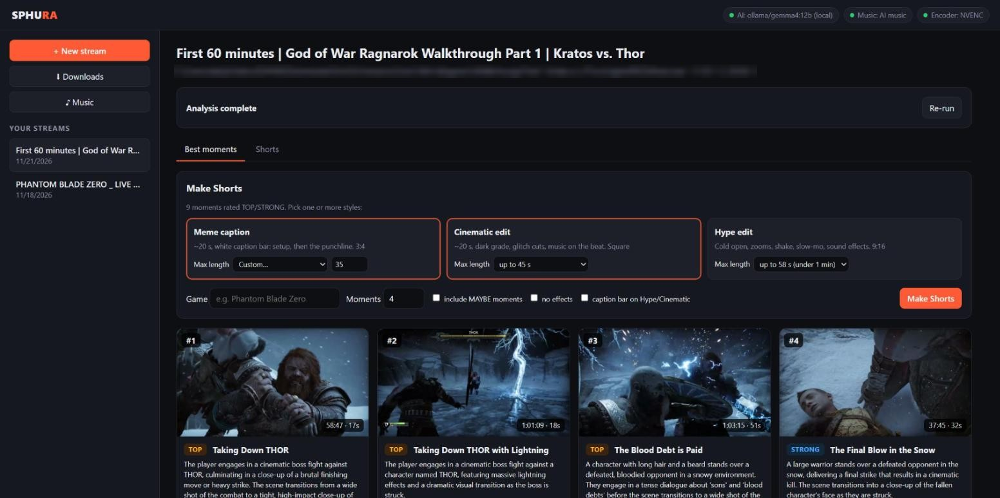
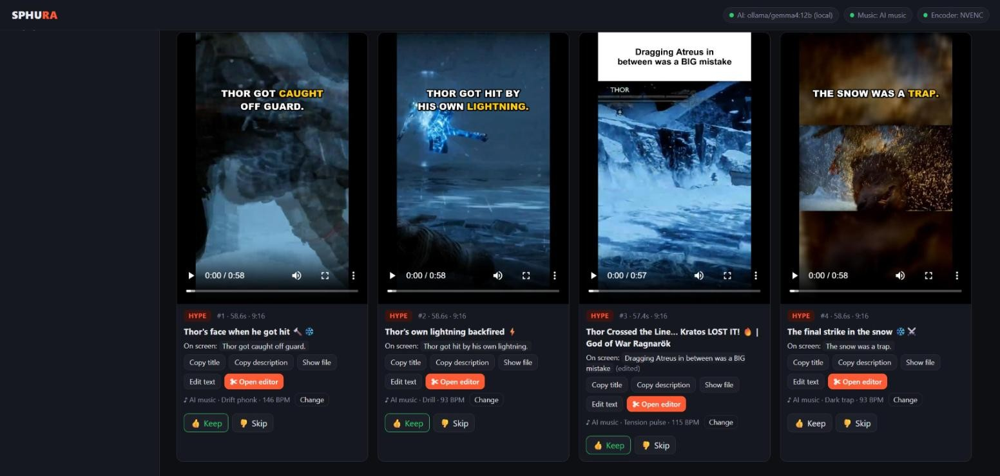
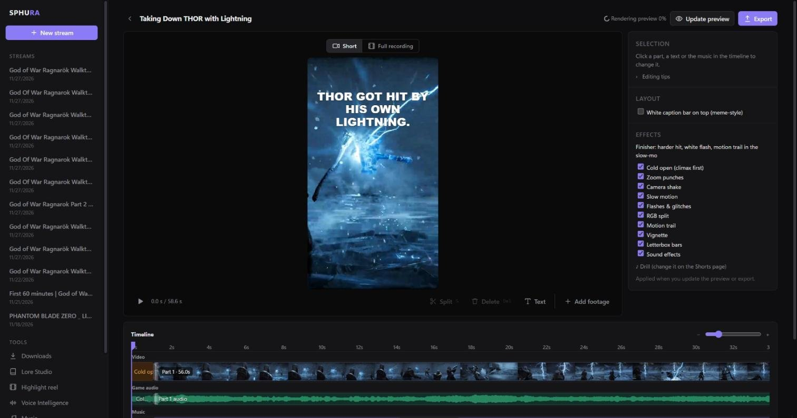
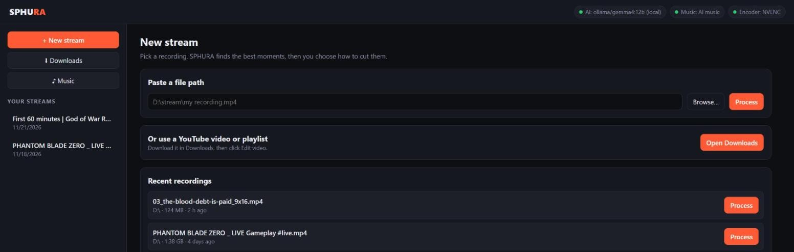
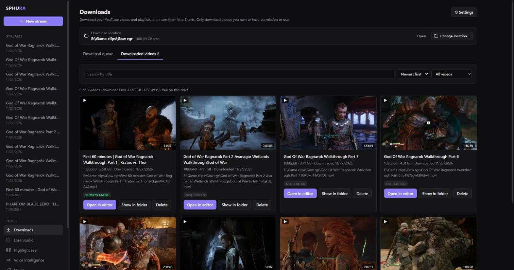

# SPHURA

**An AI-powered gaming video editor that turns long streams and recordings into ready-to-post YouTube Shorts.**

Point SPHURA at a multi-hour gameplay recording (or a YouTube video you own). It watches and listens to the whole thing, finds the moments worth sharing, and cuts each one into a vertical Short with effects, captions, music, a title, a description and hashtags. It runs on your own PC: the video never leaves it unless you choose a cloud AI judge.

Development history: [CHANGELOG.md](CHANGELOG.md) · Technical design: [docs/ARCHITECTURE.md](docs/ARCHITECTURE.md)

## Contents

- [Features](#features)
- [Screenshots](#screenshots)
- [Prerequisites](#prerequisites)
- [Installation and setup](#installation-and-setup)
- [Running SPHURA](#running-sphura)
- [Project structure](#project-structure)
- [Configuration](#configuration)
- [Troubleshooting](#troubleshooting)

## Features

| | |
|---|---|
| **Moment finding** | Audio, motion, scene-cut and speech signals over the whole video, local Whisper transcription, then an AI vision judge on the candidate moments. Long fights are detected so their finale is always kept. |
| **Three edit styles** | **Hype** (9:16: cold open, zoom punches, shake, slow-mo, sound effects), **Meme** (3:4: white caption bar with setup and punchline) and **Cinematic** (1:1: graded, glitch cuts, music on the beat). |
| **Context-matched effects** | Each moment is classified (finisher, clutch, explosion, death, funny, story, action) and gets effects to match, such as freeze-frames, letterbox bars or bigger flashes. |
| **Smart reframing** | The 9:16 crop follows the action with a smoothed virtual camera, or switches to a full-frame layout over a blurred background. |
| **Music** | Original music for every Short from a local AI model (ACE-Step 1.5) or SPHURA's built-in composer, or tracks from your own folder chosen by the AI. Cuts and the key hit land on the beat. |
| **AI Highlight Reel** | Drop in many clips or recordings; SPHURA analyses each one, ranks every moment on one scale, drops repeats of the same event and edits one highlight video (hook first, best moment last, cuts on the beat) for Shorts, Reels, TikTok, 16:9 or 1:1, with title, description, chapters, hashtags and a thumbnail. You review and reorder before it renders. |
| **Timeline editor** | CapCut-style parts with filmstrips: drag an edge outward to add footage, inward to cut, with a live preview. Separate Video, Game audio and Music tracks, a Full recording view to add other moments, text anywhere (style, size, colour, position), effect switches and the caption bar. |
| **Max length per style** | A limit, not a target: each Short keeps the length its moment needs, up to the limit you set. |
| **Copy for posting** | AI-written title, description and hashtags, checked against made-up claims, saved as a `.txt` next to each video. |
| **Taste learning** | 👍 / 👎 on moments and Shorts, and future rankings learn what you like. |
| **YouTube downloads** | A queue and library for videos and playlists you own or have permission to use: quality choice, pause/resume, crash recovery, and **Edit video** straight into the pipeline. |
| **Hardware-aware** | Tests which GPU encoders actually work (NVENC, QSV, AMF, …) and uses the GPU for transcription when it can, falling back to the CPU safely. |

## Screenshots

All screenshots are of the real app, analysing a God of War Ragnarök recording.

**Best moments and Make Shorts:** ranked moments with tiers and the AI's notes, the three styles, and a max length per style.



**Shorts:** finished Hype Shorts with AI-written on-screen text (one with the meme caption bar), titles, AI music and quick actions.



**Timeline editor:** editing a caption on the preview, with style, size, colour, effects and layout controls and the cut/text timeline.



| New stream | Downloads | Music |
|---|---|---|
|  |  |  |
| Paste or browse for a recording, use a YouTube video, or pick a recent recording. | Downloaded videos, with their editing status and **Open in editor**. | AI music status, your own tracks, and where to find royalty-free music. |

## Prerequisites

| Requirement | Notes |
|---|---|
| **OS** | Windows 10/11 is the main target: `SPHURA.bat` and the after-stream script are Windows-only. The engine also runs on macOS and Linux with `sphura ui`. |
| **Python 3.11+** | 3.12 recommended. On Windows, use the python.org installer: it includes Tk, which the **Browse…** buttons use. |
| **FFmpeg** | `ffmpeg` and `ffprobe` on `PATH` (or set `SPHURA_FFMPEG_DIR`). Use a build with **libass**, or on-screen text is skipped. Windows: `winget install Gyan.FFmpeg`. macOS: `brew install ffmpeg`. |
| **An AI judge** (one of) | **[Ollama](https://ollama.com)** with a vision model, local and free (default `gemma4:12b`: `ollama pull gemma4:12b`), **or** an **Anthropic API key** (`ANTHROPIC_API_KEY`), which sends frames and transcript lines (never the video) to Claude. Without either, SPHURA still works but ranks on signals only. |
| **GPU** (optional) | An NVIDIA GPU makes transcription, rendering (NVENC) and AI music much faster. Everything has a CPU fallback except AI music, which falls back to the built-in composer. |
| **Internet** (first use only) | Whisper models, yt-dlp + Deno (for Downloads) and ACE-Step (for AI music) are downloaded automatically when first needed. |

There's no database or other service to set up: SPHURA creates its SQLite database and runs its migrations on first start.

## Installation and setup

**1. Clone the repository**

```bash
git clone https://github.com/AdiNa1211/Sphura.git
cd Sphura
```

**2. Create the Python environment and install the engine**

`SPHURA.bat` expects the environment at `engine\.venv`, so create it there:

```bash
cd engine
python -m venv .venv
```

```bash
# Windows
.venv\Scripts\pip install -e ".[dev]"

# macOS / Linux
.venv/bin/pip install -e ".[dev]"
```

This installs FastAPI, uvicorn, pydantic, numpy and faster-whisper, plus ruff and mypy for development, and adds the `sphura` command.

**3. (NVIDIA only) Add the CUDA libraries for GPU transcription**

```bash
.venv\Scripts\pip install nvidia-cublas-cu12 nvidia-cudnn-cu12
```

SPHURA finds these automatically. If GPU transcription can't start, it falls back to the CPU.

**4. Set up the AI judge**

- **Local (recommended):** install Ollama, then `ollama pull gemma4:12b`. `SPHURA.bat` starts Ollama for you if it isn't running.
- **Cloud:** set `ANTHROPIC_API_KEY` in your environment (`setx ANTHROPIC_API_KEY "sk-ant-…"` on Windows, then open a new terminal).

**5. Check your setup**

```bash
.venv\Scripts\sphura doctor
```

This shows where FFmpeg was found, which hardware encoders work, and which Whisper model and device transcription will use.

## Running SPHURA

**Windows:** double-click **`SPHURA.bat`** in the repository folder. It starts Ollama if needed and opens `http://127.0.0.1:47821/` in your browser. Keep the console window open while you use SPHURA, and restart it after changing the code.

**Any OS:**

```bash
cd engine
.venv/bin/sphura ui              # or: .venv/bin/python -m sphura ui
.venv/bin/sphura ui --port 48000 --no-browser
```

Then:

1. **New stream:** paste a recording's path or **Browse…** for it, or pick one from **Recent recordings**. SPHURA analyses it with live progress.
2. **Best moments:** review the ranked moments.
3. **Make Shorts:** choose styles, the game name, how many moments and a max length per style, then press **Make Shorts**.
4. **Shorts:** preview, copy the title and description, change music, or open the editor.

**Highlight reel:** press **★ Highlight reel → + New highlight reel**, drop in your clips (or **Add videos…**), press **Find highlights**, review and arrange the picks, choose a platform preset, then **Generate video**.

**After a stream (Windows):** double-click **`After Stream.bat`** to process your newest OBS recording into Shorts, or drag a video onto it.

**Command line:** the full pipeline is also available in the terminal:

```bash
sphura ingest "D:\Recordings\session.mkv" --wait
sphura analyze <video or project id>
sphura highlights <project id> [--mode funny]
sphura render <project id> --top 5 --style meme --game "God of War Ragnarök" --out <folder>
sphura --help                    # all commands: ui, serve, ingest, projects, analyze, transcript,
                                 # highlights, render, clips, feedback, taste, signals, info, doctor
```

**Development checks** (from `engine/`):

```bash
ruff check src
mypy
```

There's no packaged installer yet. A Flutter desktop app and a cloud version are planned (see `apps/` and `deploy/`).

## Project structure

```text
Sphura/
├── SPHURA.bat                  # Windows launcher: starts Ollama + the browser UI
├── After Stream.bat            # one-click "turn my last OBS recording into Shorts"
├── scripts/after-stream.ps1    # what After Stream.bat runs
├── docs/
│   ├── ARCHITECTURE.md         # technical design and plan
│   └── screenshots/            # README screenshots
├── engine/                     # the application (Python)
│   ├── pyproject.toml          # dependencies, `sphura` command, ruff/mypy config
│   └── src/sphura/
│       ├── domain/             # entities: projects, clips (edit lists), jobs — no I/O
│       ├── ports/              # interfaces the core depends on
│       ├── application/        # use cases: ingest, analyse, clips/Shorts, highlight reels,
│       │                       #   downloads, library
│       ├── pipeline/           # analysis and editing logic: signals, candidates, AI judge,
│       │                       #   ranking, styles, effects, reframing, music, copywriting,
│       │                       #   reel selection (reel.py)
│       ├── infrastructure/     # adapters: FFmpeg, Whisper, Ollama/Anthropic, ACE-Step,
│       │                       #   yt-dlp, SQLite (+ migrations), job queue, storage
│       ├── api/                # FastAPI app and the browser UI's endpoints
│       ├── web/index.html      # the browser UI (single file)
│       ├── container.py        # wires adapters to the core
│       ├── config.py           # settings from environment variables
│       ├── migrate.py          # moves data from the old names (SPHURI, ClipForge)
│       └── cli.py              # the `sphura` command
├── packages/api_contract/      # OpenAPI spec exported from the engine
├── apps/                       # planned Flutter desktop and web clients
└── deploy/                     # planned cloud deployment
```

The engine follows a hexagonal design: `domain` and `application` only talk to `ports`, and `container.py` decides which adapters are plugged in. See [docs/ARCHITECTURE.md](docs/ARCHITECTURE.md).

## Configuration

Everything works with no configuration. These environment variables change the defaults:

| Variable | Default | Purpose |
|---|---|---|
| `SPHURA_AI` | `auto` | AI judge: `auto` (Anthropic if a key is set, else Ollama, else signals only), `anthropic`, `ollama` or `none` |
| `ANTHROPIC_API_KEY` | — | Enables Claude as the AI judge |
| `SPHURA_ANTHROPIC_MODEL` | `claude-sonnet-5-5` | Claude model |
| `SPHURA_OLLAMA_HOST` | `http://localhost:11434` | Ollama server |
| `SPHURA_OLLAMA_MODEL` | `gemma4:12b` | Ollama vision model |
| `SPHURA_WHISPER_MODEL` | `auto` | `large-v3-turbo` on NVIDIA GPUs, `small` on CPU |
| `SPHURA_WHISPER_DEVICE` | `auto` | `auto`, `cpu`, `cuda` or `mps` |
| `SPHURA_FFMPEG_DIR` | — | Folder with `ffmpeg` and `ffprobe` if they aren't on `PATH` |
| `SPHURA_DATA_DIR` | `%LOCALAPPDATA%\SPHURA` | Database, analysis, models, tools |
| `SPHURA_MUSIC_DIR` | `~/Music/SPHURA` | Your music tracks |
| `SPHURA_PORT` | `47821` | Port of the web UI and the API |
| `SPHURA_HOST` | `127.0.0.1` | Address `sphura serve` binds to (the web UI always stays on 127.0.0.1) |
| `SPHURA_WORKERS` | `2` | Background job workers |
| `SPHURA_API_TOKEN` | — | Requires an `X-Sphura-Token` header on `sphura serve` API calls (not used by the web UI) |

Older `SPHURI_*` and `CLIPFORGE_*` names are still read.

**Highlight reels.** Branding for reels (watermark text, logo, intro and outro clips) is set on the reel's *Customize & arrange* step and saved in `SPHURA_DATA_DIR/reel_branding.json`.

**Where files go**

| What | Where |
|---|---|
| Shorts, each with a `.txt` of title, description and hashtags | `~/Videos/SPHURA/<date> <stream name>/<style>` |
| Downloads | `~/Videos/SPHURA/Downloads` (changeable in Downloads → Settings) |
| Highlight reels, with a `.txt` (title, description, chapters, hashtags) and a thumbnail | `~/Videos/SPHURA/<date> Highlight reel - <name>` |
| Database, analysis, Whisper models, yt-dlp/Deno | `SPHURA_DATA_DIR` |
| AI music model (installed from the **Music** page) | `ai/ace-step` inside the repository folder |

## Troubleshooting

| Problem | Fix |
|---|---|
| **"AI judge: off" / "No AI judge: start Ollama, then restart SPHURA"** | Start Ollama (`ollama serve` or its tray app), make sure the model is pulled (`ollama pull gemma4:12b`), then restart SPHURA. |
| **"ffmpeg not found"** | Install FFmpeg and open a new terminal so `PATH` is updated, or set `SPHURA_FFMPEG_DIR`. Run `sphura doctor` to check. |
| **No on-screen text in renders** | Your FFmpeg build has no libass. Install a full build (e.g. `winget install Gyan.FFmpeg`). |
| **Rendering uses the CPU** | `sphura doctor --refresh` re-tests the GPU encoders, e.g. after a driver update. |
| **Transcription is slow on an NVIDIA PC** | Install the CUDA libraries (setup step 3), then run `sphura doctor --refresh`. |
| **Code changes don't show up** | Close the SPHURA console window and start `SPHURA.bat` again; refreshing the page reloads only the UI. |
| **"Not Found" after updating** | Same cause: the running server is older than the page. Restart SPHURA. |
| **Page won't load / port in use** | Something else is on port 47821. Start with `sphura ui --port 48000` or set `SPHURA_PORT`. |
| **Browse… says it couldn't open the picker** | Your Python has no Tk. Reinstall Python from python.org, or paste the path instead. |
| **AI music takes minutes** | The first song after a restart loads the model; later ones are much faster. If AI music fails, SPHURA uses its built-in composer. |
| **A YouTube download fails** | Private, members-only, Premium, live and still-processing videos can't be downloaded. A stream that just ended may need a few hours to finish processing on YouTube. |
| **Downloads stopped after a restart** | They resume by themselves: interrupted downloads go back to the queue and continue from their partial files. |

## License

No license has been chosen yet. All rights reserved by the author until one is added.
